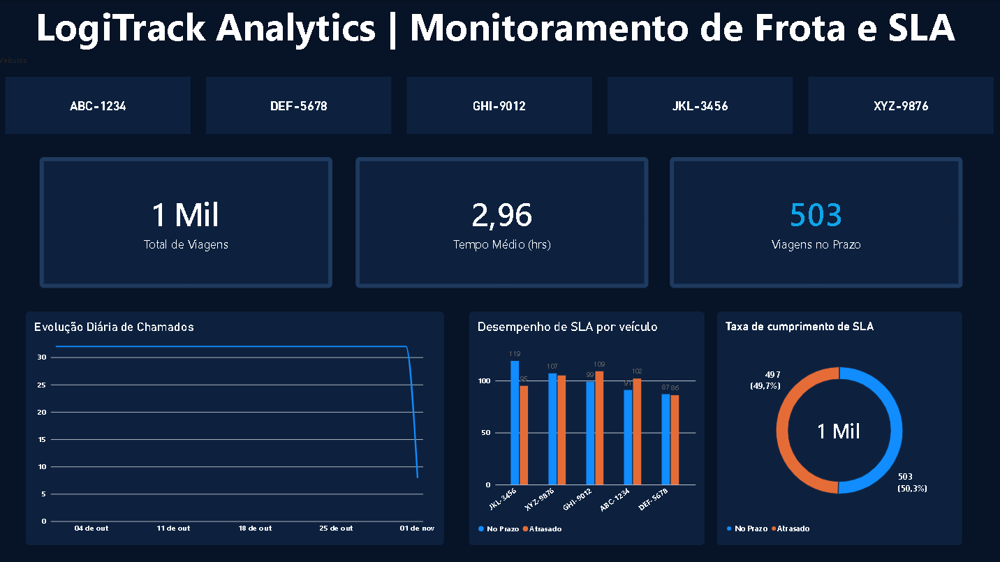

# 🚚 LogiTrack Analytics | Monitoramento de Frota e SLA

## 🎯 Visão Geral do Projeto
O **LogiTrack Analytics** é uma solução completa (*End-to-End*) de Engenharia e Análise de Dados desenvolvida para monitorar a eficiência operacional de uma frota logística. O pipeline automatiza a ingestão de dados transacionais, aplica regras de negócio diretamente no banco de dados em nuvem e entrega um painel executivo interativo para tomada de decisão sobre o cumprimento de **SLA (Service Level Agreement)**.

---

## 🏗️ Arquitetura e Stack Tecnológica

O fluxo de dados segue uma arquitetura moderna e desacoplada:

1. **Ingestão e ETL (Python):** Geração e tratamento de **1.000 registros operacionais** utilizando `Pandas` e `SQLAlchemy`, com carga automatizada via conexão Pooler IPv4.
2. **Data Warehouse em Nuvem (PostgreSQL / Supabase):** Armazenamento relacional na tabela fato (`tb_operacoes`) e criação de uma camada semântica via **View SQL (`vw_fatos_operacao`)**, responsável por calcular o tempo de ciclo (`horas_ciclo`) e classificar automaticamente cada viagem dentro da meta de **3,0 horas** (`No Prazo` vs. `Atrasado`).
3. **Business Intelligence (Power BI):** Modelagem analítica conectada diretamente à camada semântica (`vw_fatos_operacao`), utilizando agregações nativas sobre a tabela fato e filtros dinâmicos por veículo para garantir alta performance e baixa latência visual.

---

## 📊 Principais Insights de Negócio

A análise das **1.000 ordens de serviço** operacionais revelou os seguintes indicadores para a gestão:

* **Equilíbrio Crítico no SLA:** A operação atingiu **50,3% de cumprimento de SLA (503 viagens no prazo)** contra **49,7% de atrasos (497 viagens)**, evidenciando a necessidade de otimização de rotas e despacho.
* **Operação no Limite da Meta:** O tempo médio global de ciclo ficou em **2,96 horas** — apenas 0,04h abaixo do teto estipulado de 3,0 horas, explicando a alta sensibilidade a atrasos em horários de pico.
* **Desempenho por Veículo:** A placa **JKL-3456** liderou a eficiência operacional com **119 viagens no prazo** contra 95 atrasadas. Em contrapartida, os veículos **GHI-9012** (109 atrasos vs. 99 no prazo) e **ABC-1234** (102 atrasos vs. 91 no prazo) apresentaram gargalos recorrentes.
* **Estabilidade de Demanda:** O volume diário manteve-se constante em **32 chamados/dia** ao longo de outubro, registrando redução apenas no encerramento da janela analisada (início de novembro).

---

## 🎯 Recomendações para a Operação

Com base nos gargalos identificados no painel, sugerem-se duas frentes imediatas de ação:

* **Auditoria de Rota e Despacho:** Investigar os atendimentos das placas **GHI-9012** e **ABC-1234** para identificar se os atrasos decorrem de gargalos geográficos, janelas de tráfego ou tempo de carregamento em pátio.
* **Alerta Preventivo de SLA:** Implementar gatilhos operacionais quando uma ordem atingir **2,5 horas** de ciclo, criando uma margem de segurança de 30 minutos para intervenção antes do estouro da meta de 3,0 horas.

---

## 💡 Decisões Técnicas (Por que centralizar no SQL?)
Em vez de sobrecarregar o Power BI com colunas calculadas e medidas complexas, toda a regra de negócio de SLA e cálculo de diferença de timestamps foi consolidada na **View SQL (`vw_fatos_operacao`)**. Essa abordagem garante fonte única da verdade (*Single Source of Truth*), facilita a manutenção caso a meta de horas mude no futuro e mantém o dashboard leve.

---

## ⚙️ Como Reproduzir o Projeto

1. **Banco de Dados:** Crie um projeto gratuito no **Supabase** e copie a URI de conexão (Transaction/Session Pooler IPv4).
2. **Carga ETL:** Abra o notebook `etl_logitrack.ipynb` no Google Colab, insira sua string de conexão na engine do `SQLAlchemy` e execute as células para popular a tabela `tb_operacoes`.
3. **Camada Semântica:** No *SQL Editor* do Supabase, execute o script `view_fatos_operacao.sql` para criar a View analítica.
4. **Visualização:** Abra o arquivo `.pbix` no Power BI Desktop, atualize as credenciais da fonte de dados PostgreSQL apontando para o seu banco e clique em **Atualizar**.

---

## 📂 Estrutura do Repositório

* `etl_logitrack.ipynb` — Notebook Python (Google Colab) responsável pelo tratamento e ingestão dos dados no PostgreSQL.
* `view_fatos_operacao.sql` — Código DDL da View SQL com a lógica de cálculo de ciclo e regra de SLA.
* `LogiTrack_Analytics_Monitoramento_de_Frota_e_SLA.pbix` — Arquivo do projeto no Power BI com o modelo e o painel interativo.
* `dashboard_logitrack.png` — Captura de tela do painel final.

---
*Nota: Os dados utilizados neste projeto foram gerados sinteticamente para fins de simulação operacional, estudo de arquitetura de dados e demonstração de portfólio.*
